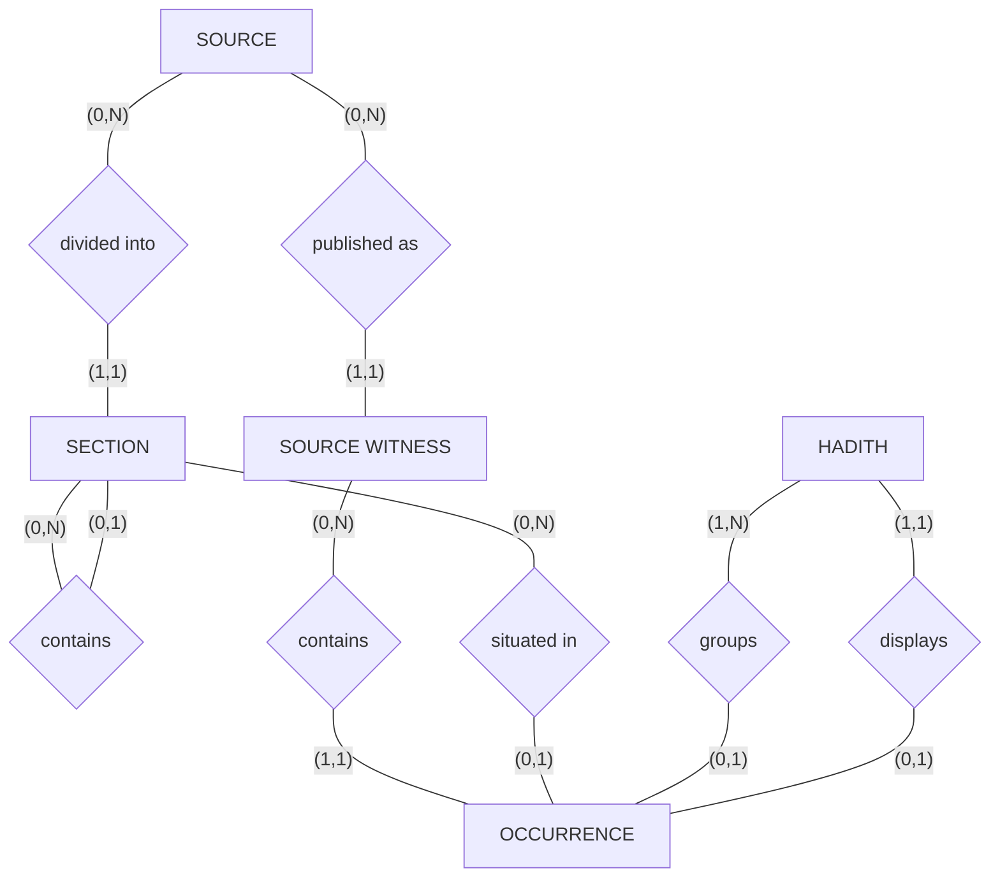
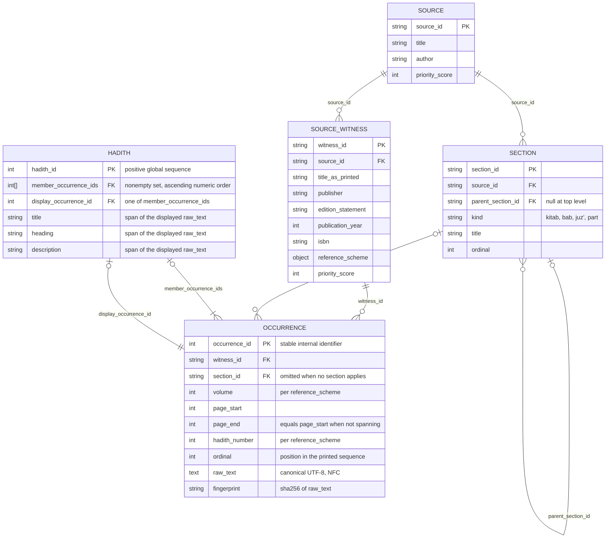

# Data Model

This document defines the entities of Open Hadith, the relationships between them, and the schema they produce. It builds on the vocabulary in [terms.md](terms.md), the commitments in [principles.md](principles.md), and the layers in [layers.md](layers.md).

Open Hadith preserves text from print editions and publishes it as public HTML. The model serves both. Preservation decides what may be stored; publication decides what must be addressable by a stable identifier. Where the two pull against each other, the model says which one gives way.

## Entities

### Source

A work, taken apart from any particular copy: *Forty Nawawi*, *Sahih al-Bukhari*, *Sahih Muslim*.

A source carries a required integer priority score from `0` through `100` expressing the relative authority of the work itself. Zero is the ordinary baseline, and only ordering has meaning. The score influences which text a hadith displays; the algorithm that consumes it is a governance decision and is not fixed here.

The definition is deliberately general. A hadith-grading work is also a source, its printed edition a source witness, and its verdicts occurrences within it. No separate machinery is required when such works are added.

### Source Witness

A specific published printing of a source, identified by the details that let another person obtain an interchangeable copy: title as printed, publisher, complete edition or printing statement, Gregorian publication year, and ISBN-13. Two physical copies of the same printing are one source witness; a distinguishable edition or printing is another. A printing outside those version-one bibliographic forms requires explicit schema review rather than an empty or improvised value.

A witness declares its own reference scheme. A page span is universal; the scheme records whether that printing also uses volumes or printed hadith numbers. Editions disagree about how to point at a text, and without a declared scheme an absent volume cannot be distinguished from a forgotten one.

A witness also carries a required integer priority score from `0` through `100`, expressing the relative quality of that edition. Zero is the ordinary baseline, and only ordering has meaning. It is distinct from the score on the source: the authority of a work and the care of a printing are different judgements, and both bear on which text is published.

### Section

A division of a source, as its author divided it: *kitab*, *bab*, *juz'*, part, or whatever divisions the work itself uses.

Sections nest to any depth and record what kind of division they are. They are not a fixed two-level hierarchy, because works are not organised alike, and a source may have none at all.

Each section has a source-wide positive ordinal in depth-first printed order. The ordinals are unique and contiguous from `1`, so flat records reproduce the complete authored sequence without deriving order from identifiers or directory traversal. Version one recognizes the controlled kinds `kitab`, `bab`, `fasl`, `juz`, and `qism`.

A section belongs to the source, not to any witness. The structure is the author's; a publisher's decision to bind a work in four volumes rather than six is an edition's property and is recorded in that witness's reference scheme instead.

### Occurrence

A single appearance of a text at a specific location within a source witness. It is the unit of preservation.

An occurrence holds its raw text — canonical UTF-8, opaque, isnad and matn together exactly as printed — its location within the witness, the fingerprint of its text, and a stable internal identifier assigned to it. The identifier is separate from the citation that lets a person find the occurrence. It may also record the section of the work it falls within.

Raw text is the report body. It includes punctuation, diacritics, bracketed text, and variants presented as part of the report, but excludes running headers, page numbers, decorative numbering, section headings, and editorial footnotes.

A location spans pages where the printed text does. A narration crossing a page break records where it begins and where it ends; a narration confined to one page records the same page for both.

An occurrence also records its ordinal: its position in the printed sequence of its witness. Editions that number their texts supply an order already, but many do not, and page alone cannot order two texts printed on the same page. The sequence is a fact about the book, recoverable only while the book is open, and it is what allows a section to be presented in the order its author arranged it.

Occurrence ordinals are unique and contiguous from `1` within a source witness, so authoritative ingestion follows printed report order. An occurrence carries no reference to a hadith; grouping is recorded on hadith records, and an occurrence that no hadith lists is not yet grouped. Omitted section membership affirmatively means that no section applies, not that an applicable section remains unrecorded.

An occurrence belonging to no hadith is a valid and expected state. Ingestion produces occurrences and nothing else; grouping them is separate, later work.

### Hadith

The canonical unit. A hadith gathers the occurrences of one narration wherever it appears — across editions and, more importantly, across works — selects one of them to supply its published text, and owns the public address at which it is served.

It is the only entity Open Hadith authors. A source, a witness, and an occurrence are all discoveries: a work exists, a book exists, ink on a page exists. A hadith is a judgement that several appearances are one narration.

That judgement is still authoritative core data. The core holds the source-bound records and, beside them, the human-reviewed hadith records that group them. A hadith record is not derived and cannot be regenerated from the others; it is kept, verified, and preserved under the same rules as the records it groups.

That judgement is made deliberately. Scripts and assisted review propose candidates — whether a narration is already recorded, whether a new occurrence belongs with existing ones — and a person decides. Hadith are not regenerated. An existing hadith is altered only to correct a clear mistake.

The published text is selected, never composed. Where occurrences differ, the one that best represents their weighted agreement is published verbatim, in full, as one witness printed it. Open Hadith does not assemble a text that no edition contains.

A hadith also carries the text its page needs to be found: a title, a heading, and a description. These are chosen when the hadith is minted, by the same combination of scripts, assisted review, and human decision. They are drawn from the displayed occurrence and never written, which keeps a published page free of any sentence the project composed. Every occurrence a hadith gathers is presented on that page beneath the selected text, with its edition and location, so that a reader sees each appearance in full rather than a single version standing for all of them.

The title, heading, and description are nonempty single-line contiguous spans that begin and end on extended grapheme-cluster boundaries, so none starts or stops partway through a letter and its marks. They may overlap or be identical, but they cannot join passages, cross a stored line boundary, normalize characters, paraphrase, or add punctuation.

Membership is recorded once, on the hadith, as the set of its occurrence identifiers. The set is written in strictly ascending numeric order so that one membership has one representation; the order carries no editorial or display meaning, and the displayed occurrence is chosen separately. Occurrence records carry no reference back, so a reviewed change to a grouping edits hadith records and never rewrites preserved text.

## Conceptual structure

Entities are rectangles, relationships diamonds. Each line carries the participation of the entity it touches, written as (minimum, maximum).

Four readings carry most of the meaning.

Every witness belongs to exactly one source, and every occurrence to exactly one witness. Provenance is mandatory at both steps, and nothing enters the record without it.

A section's parent is another section, or nothing. This is what allows a work to be divided as its author divided it, however deeply.

An occurrence may belong to no hadith. This is not an incomplete record; it is preservation that has run ahead of judgement, which is the intended order.

A hadith groups at least one occurrence and displays exactly one. The displayed occurrence is necessarily among those it groups.

## Relational schema

References between `HADITH` and `OCCURRENCE` run one way. A hadith names every occurrence it groups and the one it displays; an occurrence names no hadith. Source-bound records therefore never depend on a grouping judgement, and changing that judgement touches only hadith records. The constraints below keep the one-way references consistent.

## Constraints

These are the rules verification enforces. Each fails on what a machine can prove.

**Provenance is mandatory.** `witness_id` on an occurrence and `source_id` on a witness are never absent, and must resolve to a registered record.

**Identity is stable.** Every occurrence has one unique internal identifier. The identifier is assigned once, never reused, and remains fixed when raw text or location metadata is corrected.

**Location matches the witness.** Every occurrence supplies its starting and ending page. It supplies a volume when the witness has volumes and a printed hadith number when the printing assigns one.

**Location and identity are separate.** Location exists to let a person find the occurrence in the witness; it is not the occurrence's identifier. An ordinal distinguishes and orders multiple occurrences printed on the same page.

**Fingerprints match.** An occurrence's fingerprint is the SHA-256 of the canonical bytes of its raw text, recomputed on every change.

**Corrections restore fidelity.** Raw text changes only when it does not match the cited source witness. Errors and irregularities printed by the witness are preserved.

**A section stays within its source.** A section's parent belongs to the same source as the section itself.

**Section structure is total.** Section ordinals are unique and contiguous within a source, parents precede descendants, and the parent graph has no self-reference or cycle.

**The displayed occurrence is a grouped occurrence.** A hadith's `display_occurrence_id` must appear in its own `member_occurrence_ids` and resolve to exactly one occurrence. A hadith cannot publish text it does not gather.

**A hadith is never empty.** Every hadith lists at least one occurrence, and every listed identifier resolves to exactly one occurrence. A hadith of one occurrence is valid.

**An occurrence belongs to at most one hadith.** No occurrence identifier appears in the member lists of two hadith, whether or not either displays it. An occurrence, by contrast, may belong to none.

**Membership has one representation.** A member list contains no repeated identifier and is written in strictly ascending numeric order.

**Published text is drawn, not written.** A hadith's title, heading, and description each appear verbatim within the raw text of the occurrence it displays, in at least one place where the span starts and ends on extended grapheme-cluster boundaries. No page presents a sentence that no edition printed, and the rule is checkable rather than merely stated.

**Sequence is complete within a witness.** Occurrence ordinals are unique and contiguous from `1`, so the printed order is always total and authoritative ingestion proceeds in that order.

**A location does not end before it begins.** An occurrence's ending page is never earlier than its starting page.

## Addressing

A hadith receives a positive global sequential integer, beginning at `1`, and is served at the canonical address `/h/<id>/`. The integer has no leading zeroes: hadith `13` is served at `/h/13/`. A narration that appears in Bukhari, Muslim, and Forty Nawawi belongs to none of them exclusively, and an address implying otherwise would assert a claim the project does not make.

The next identifier is one greater than the highest identifier ever minted. Identifiers are never reused, and gaps carry no meaning. The sequence expresses minting order only; it does not reproduce the numbering of any source.

Books and sections are addressable in their own right, at `/b/<source>/` and `/b/<source>/<section>`. These pages aggregate; they present no text that is not already preserved.

A section is presented as one witness printed it, in that witness's order, so that the page reflects a book a reader can hold rather than a composite of several. Where a source has more than one witness, the one with the highest priority score presents it, and equal scores are settled on the witness identifier so that a build is never left to chance. The same score therefore governs both which occurrence a hadith displays and which witness presents a section; raising it to correct one will also change the other.

Identifiers behind published addresses are permanent. They are not reused, renumbered, or recomputed. Where a hadith must be split, the original identifier is retained with the narration closest to its established meaning and every additional result receives a new identifier. Where two must be joined, the older identifier survives and the newer becomes a permanent redirect. Where a hadith must be withdrawn, its address remains as a tombstone explaining that the identifier was withdrawn. These operations are avoided by deciding carefully before minting rather than by correcting afterwards.

The trailing slash is part of the canonical address. A host may redirect the slashless form, such as `/h/13`, to `/h/13/` as a convenience, but the two forms are not separate identifiers.

## What the model excludes

**Translations.** Permanently. The corpus and the site are Arabic. English appears only where machines require it, in identifiers and addresses.

**Any internal structure of the text.** Raw text is one field. Isnad and matn are not separated, and narrators are not modelled, because both are editorial judgements made at ingestion and the model makes as few of those as possible.

**Normalized text.** Comparing occurrences requires setting aside tashkil, tatweel, and punctuation, but that form exists only while a comparison runs. It is never stored, because the data policy admits exactly one representation of a text.

**Grading.** Not yet carried, and it will need no new entity when it is: a grading work is a source like any other.

**Relationships between records.** Grouping by hadith expresses sameness, which was the whole of their early purpose, and it lives in the core as reviewed hadith records. A relationship entity for assertions that are not sameness remains deferred until such assertions arrive.
