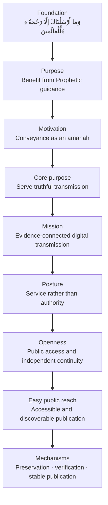

# The Soul of Hadith Archive

This document states why Hadith Archive exists, what it serves, and what it must remain.

## The foundation

> **﴿وَمَا أَرْسَلْنَاكَ إِلَّا رَحْمَةً لِّلْعَالَمِينَ﴾**
>
> **سورة الأنبياء، الآية ١٠٧**

Hadith carries transmitted reports of the words, actions, approvals, character, and example of the Messenger of Allah ﷺ. Through it, people seek knowledge of him and benefit from his guidance.

Hadith Archive exists in service of that benefit.

## The motivation

> **«بَلِّغُوا عَنِّي وَلَوْ آيَةً»**
>
> **صحيح البخاري، ٣٤٦١**

Hadith travelled across generations through people. Scholars named transmitters, examined chains, compared wordings, recorded differences, distinguished reports, and preserved collections. Transmission was treated as an amanah, not as the movement of text alone.

This call to convey motivates Hadith Archive. Conveyance must carry forward the responsibility attached to what is being transmitted, not only its words.

## The core purpose

**To serve the truthful transmission of hadith.**

Truthful transmission preserves what was received without silently replacing it with what seems preferable. Hadith Archive does not correct, rewrite, modernize, abridge, linguistically normalize, or harmonize the wording printed by a source witness. Printed errors and differences remain part of that witness.

When the project transcribes a witness incorrectly, the stored text is corrected only to restore agreement with what was printed. The source is the authority for the occurrence; Hadith Archive is its faithful carrier.

## The digital problem

The digital world made transmission immediate and vast, but weakened its visible connection to evidence.

Text is copied without its source. Edition details disappear. Wordings are silently corrected, shortened, normalized, or combined. References spread without a traceable basis. Websites copy one another, databases change behind stable-looking interfaces, and private corpora disappear with their custodians. Search engines and AI systems multiply these problems at a scale no earlier medium allowed.

The internet does not merely need more hadith text. It needs transmission that remains accountable as it becomes digital.

## The mission

**Hadith Archive exists so that hadith can travel through the digital world without losing its connection to evidence.**

Each preserved occurrence remains bound to a specific physical source witness and a location another person can reach. Its wording is preserved as printed. Human judgements remain distinct from observed source facts. Corrections remain visible. Machines prove only what machines can establish.

Preservation and publication are one mission. Preservation without reach leaves the knowledge difficult to encounter. Publication without evidence allows reach to outrun integrity.

## The posture

**Hadith Archive is a servant of transmission, not an authority over hadith.**

The project does not ask to be trusted beyond the evidence it exposes. It does not replace scholars, libraries, publishers, teachers, physical books, or the disciplines that evaluate authenticity and meaning.

Its claim is deliberately narrow: this identified source witness prints this wording at this location, this is what Hadith Archive preserved from it, and these are the human judgements made afterward.

Agreement between the stored text and the printed page ultimately requires a person holding the edition. The project makes that verification possible; it cannot perform it on its own.

## Openness

The mission must remain open. Public knowledge cannot depend on a subscription, proprietary platform, private database, or the continued existence of one custodian.

Hadith Archive publishes data and pages without a paywall or required account. Its evidence, human judgements, and correction history are inspectable. Its formats and addresses are public. Its corpus can be downloaded, reused, mirrored, and preserved independently. Humans, researchers, applications, and AI systems may build from the same accountable core.

Openness does not remove governance. Access and reuse are open; admission to the authoritative core remains governed by evidence and review. Physical source material is cited, not redistributed without the right to do so.

The work is genuinely open only when its mission can survive its original maintainers.

## Easy public reach

Open data is not enough if only specialists know where to find it or how to use it. Hadith must be easy to reach where people already search, read, link, and share.

Hadith Archive publishes the corpus as accessible static HTML, not merely as downloadable data. Every hadith has a stable public address. Its page can be indexed by search engines, opened without an account or special software, and followed back to its preserved occurrences and source witnesses.

Public reach also includes machines. Applications and AI systems receive structured access to the same accountable core that serves the human-readable pages. Reach never requires a second, less traceable version of the knowledge.

## What is unique about Hadith Archive

No single mechanism defines Hadith Archive. Its distinction is the combination of evidence, identity, and reach in one public system.

Hadith Archive preserves occurrences from specific physical print editions instead of silently producing one composite text. It gives each hadith a stable identity without hiding the distinct witnesses in which it occurs. It publishes accessible pages for ordinary readers while exposing the same provenance to researchers, applications, and AI systems. It separates source observation from human judgement and makes both inspectable.

It also treats seven guarantees as one responsibility:

| Aim | What it protects |
|---|---|
| **Fidelity** | The wording of the source witness is preserved rather than improved. |
| **Integrity** | Any change to preserved content can be detected. |
| **Traceability** | Every accepted change can be inspected and attributed. |
| **Non-repudiation** | Every accepted action is bound to a verified identity. |
| **Availability** | The corpus can be obtained without depending on one interface or service. |
| **Durability** | The corpus can survive deletion, corruption, and the failure of one custodian. |
| **Longevity** | The records remain readable beyond the tools and people that created them. |

These are not independent technical features. Fidelity without integrity cannot be trusted over time. Integrity without traceability hides how change occurred. Preservation without availability cannot serve the public. Availability without durability or longevity lasts only as long as the current system. Hadith Archive is designed to uphold them together.

Preservation and distribution are equally necessary. A precise archive that people cannot reach leaves the guidance hidden. A popular page without actionable evidence asks for trust it has not earned. Hadith Archive joins both: faithful preservation beneath open, durable, and discoverable publication.

## The layers

Each outer layer serves the one within it.

Technology belongs at the outermost layer. It may change without changing the purpose. Easy public reach makes open knowledge encounterable. Openness keeps it available beyond any one custodian. The posture governs how the mission is carried out. The core purpose names the work, the motivation calls it forward, and the foundation explains why it matters.

## The goals

Hadith Archive aims to:

1. carry Prophetic guidance into the digital world with care;
2. preserve edition-specific wording and provenance;
3. make independent verification practical;
4. separate observed evidence from human judgement;
5. give hadith stable, public, and reusable addresses;
6. make the corpus easy to discover as accessible static HTML, not merely downloadable data;
7. remain correctable without concealing history; and
8. outlive any one application, organization, or custodian.

## The measure

Scale is not success when provenance is lost.

Hadith Archive succeeds when a person can move from a digital hadith toward its evidence rather than being asked to accept an unexplained claim. It succeeds when the same accountable foundation serves readers, scholars, developers, and machines without creating separate versions of truth. It succeeds when mistakes can be corrected openly and the corpus can endure beyond the people and software that created it.

Every future decision must answer one question:

> **Does this help the guidance carried through hadith reach people more faithfully, openly, and responsibly?**
