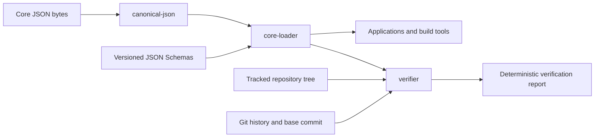

# Core Toolchain

This document defines the high-level software architecture that reads and verifies Hadith Archive core data. It explains the responsibilities and trust boundaries of `canonical-json`, `core-loader`, and `verifier`. Detailed byte rules remain in [data-policy.md](data-policy.md), entity meaning remains in [model.md](model.md), and the structural and verification contracts remain in [schema.md](schema.md).

The three packages form a one-directional control chain. They are not three interchangeable validators. Each answers a different question, and each later boundary relies on the guarantees of the earlier boundary without expanding its authority.

## Architecture



The arrows express dependency and trust direction. `canonical-json` knows nothing about Hadith Archive entities or repository layout. `core-loader` adds the versioned structural contract but knows nothing about whole-repository relationships or Git history. `verifier` adds repository-wide and historical checks but never becomes a data source. No arrow points back toward an earlier boundary, and none of the three packages writes authoritative core data.

## The three questions

| Boundary | Question answered | Successful guarantee | Deliberately not guaranteed |
|---|---|---|---|
| `canonical-json` | Are these bytes the one approved JSON representation? | The bytes decode, parse without duplicate keys, and exactly match canonical JSON policy. | Entity type, schema validity, repository path, relationships, or source accuracy. |
| `core-loader` | Is this one canonical object a structurally valid Hadith Archive record? | The declared type and version select a known schema, structural validation passes, and the returned typed record is deeply immutable. | Semantic checks, foreign references, uniqueness, path agreement, history, or agreement with a printed witness. |
| `verifier` | Does this repository state obey every applicable machine-checkable project rule? | Verification completed and every applicable versioned rule passed. | Scholarly judgement or proof that a transcription matches ink on a physical page. |

A later success includes the earlier guarantees. A verifier cannot evaluate a record as structurally valid before its canonical bytes are trusted, and it cannot evaluate relationships before the record is structurally valid. A canonical or structurally valid record may still be false, misplaced, inconsistent, or historically impermissible.

## `canonical-json`

`packages/canonical-json/` owns deterministic JSON representation. It is a general byte and value boundary rather than an Hadith Archive record library.

For canonical input, it:

1. decodes UTF-8 without accepting malformed input or a byte-order mark;
2. enforces LF and the exact final-newline rule;
3. parses with duplicate-key detection, lossless integer handling, rejection of any string or key that is not a sequence of Unicode scalar values, and a limit of 64 levels of object and array nesting, so arbitrarily deep input fails with a stable code instead of exhausting the call stack;
4. requires one top-level object for a canonical core JSON file;
5. checks NFC and the canonical integer-only numeric domain;
6. formats the parsed value deterministically and compares the expected bytes with the input.

Successful parsing returns the JSON value represented by those exact bytes. Failure identifies the violated representation boundary with a stable code and, where meaningful, a byte offset. The package does not consult JSON Schemas, infer record types, traverse the repository, or decide whether content is correct.

Formatting is explicit and separate from verification. The formatter rejects an in-memory string or key containing an unpaired surrogate rather than escaping it, and a value nested more deeply than the parser accepts. A formatter may produce canonical bytes for provisional data, but verification never repairs a file silently. This distinction preserves reviewability: an invalid representation remains visible until a deliberate change corrects it.

## `core-loader`

`packages/core-loader/` is the supported read-only entry point for individual authoritative records. It combines canonical byte handling with the exact versioned structural schemas.

Loader initialization reads the six local schemas, verifies their declared identifiers, validates them against JSON Schema Draft 2020-12, registers their exact local references, and compiles the five entity schemas without network access. If that trusted catalog cannot be established, initialization fails because no record can be loaded safely.

For each file or byte sequence, the loader:

1. requires canonical bytes through `canonical-json`;
2. reads `record_type` and `schema_version` from the canonical object;
3. selects the one known schema for that exact pair;
4. performs strict structural validation without coercion, defaults, property removal, or mutation;
5. deep-freezes the validated value;
6. returns it as the generated discriminated TypeScript record union.

Expected input failures are structured results. File access, canonical representation, unknown record-schema pairs, and structural schema failures remain distinguishable. Successful records are readonly at compile time and recursively frozen at runtime, so downstream code cannot accidentally turn loaded data into a competing in-memory authority.

The TypeScript bindings are generated from the authoritative schemas and committed beside the loader. A deterministic freshness check compares regenerated source byte for byte with the committed binding. The generated interfaces improve development and navigation, but runtime validation remains mandatory and JSON Schema remains authoritative.

The loader intentionally stops at one-record structure. It does not decide whether a record occupies the correct path, whether an identifier is unique, whether another record exists, whether a fingerprint matches, whether a page range is ordered, or whether an identifier was reused. Adding those checks to the loader would make an ordinary record read depend on the whole repository and would blur the boundary between consumption and verification.

## `verifier`

`packages/verifier/` is the repository admission control. It consumes the loader boundary and adds the context that a single-record loader deliberately lacks: tracked paths, the complete record set, cross-record indexes, an explicit Git base, and repository history.

Verification runs in prerequisite order:

1. discover the required tracked files and trusted repository context;
2. check byte representation before trusting parsed values;
3. establish the schema catalog and load structurally valid records;
4. evaluate record-local semantic rules;
5. build indexes and evaluate uniqueness, ordering, and relationships;
6. evaluate historical permanence and minting rules against the resolved base commit;
7. sort all safely evaluable findings and serialize one deterministic report.

The candidate repository state is the Git index. Stage changes before running the verifier: it reads captured staged blob IDs rather than working-tree files, so unstaged edits, missing local files, or replaced symlink targets cannot change the bytes being verified. Core and schema entries must be regular Git files; symlinks and submodules produce `file.regular` findings and exit status `1`. Every entry at or beneath `core` must also sit at one of the five record paths; anything else, including an entry under a case-variant root such as `Core/` or `CORE/`, produces a `repository.core_paths` finding judged from the path alone. Likewise, every entry at or beneath `schemas` must be one of the six registered catalog schemas; an unregistered version or entity schema, or an entry under a case-variant root such as `Schemas/`, produces a `repository.schema_paths` finding. Case aliases are rejected, not normalized. Unresolved index conflicts make verification incomplete. Historical checks still read committed Git objects against the explicit base.

Intent-to-add placeholders (`git add -N`) are excluded because they are not part of the tree Git would commit; a genuinely staged empty file is still checked. Candidate enumeration and blob reads disable local Git replacement objects so the verifier reads the original indexed bytes.

History loading walks changes under `core/` and `schemas/` along the resolved base's first-parent history. Merge commits contribute their changes relative to the first parent. One persistent Git batch reader loads blobs, and an invocation-local object cache avoids parsing unchanged records again. Historical deletions, identity changes, and changes to used schemas remain violations even if later commits restore the original files. Schema dependencies are evaluated after all changes in each commit have been applied. This bounds Git process usage independently of the number of records or ingestion commits; it does not change base selection or the historical rules.

Both `bun run verify --base <accepted-base-commit>` and `bun run check --base <accepted-base-commit>` require the caller to name the accepted historical base. For a feature branch, fetch the target branch and use its merge base with `HEAD`; update against the latest target and rerun verification before merging. Feature-branch draft commits must not be supplied as accepted history. A post-merge check uses the accepted target commit before the merge. The verifier requires the supplied base to resolve to an ancestor of `HEAD`, but does not independently establish that the caller selected an accepted target-branch commit.

Historical checks require the complete Git history. Before resolving the base or walking history, the verifier asks Git `rev-parse --is-shallow-repository` (with replacement objects disabled, like every other history read), which also works in linked worktrees whose `.git` is a gitfile. Every shallow repository is rejected, whatever its depth and even when the supplied base is present, because grafted roots hide earlier deletions and identifier use; verification is then incomplete (`history_unavailable`), exits with status `2`, writes no report, and states that full history is required. Any answer other than an explicit non-shallow result is also treated as unavailable history. The verifier never fetches on the caller's behalf. Recover with `git fetch --unshallow`, or in CI check out with `actions/checkout` and `fetch-depth: 0`, then rerun with the same explicit accepted base; base selection is unchanged.

A failed prerequisite invalidates the repository and prevents only checks that cannot be evaluated honestly. It never becomes a false pass for dependent rules. Missing schemas, unavailable required history, internal errors, and incomplete execution cannot produce a valid report.

The verifier reports findings; it does not fix them. Its machine report contains only the current verification-catalog version, validity, and sorted findings. The catalog is at version three, independent of the draft version-one record schemas, and a report claiming any other catalog version is refused rather than serialized. Terminal presentation is derived from that report. Exit status `0` means complete success, `1` means complete verification found rule failures, and `2` means verification could not complete.

Verification proves repository consistency under the published machine rules. It cannot prove that preserved text matches the cited physical source witness or that a human-authored grouping is scholarly correct. Those claims remain independently checkable because the core records preserve the exact witness and location needed for human review.

## How the boundaries are used

Applications and static builders use `core-loader` or deterministic artifacts built through it. They do not run historical repository verification for every ordinary read, and they do not use unchecked `JSON.parse` results as core records.

Continuous integration and maintainers use `verifier` before admitting changes to authoritative data. Passing package tests proves the tools behave as specified; passing repository verification proves the candidate repository state satisfies the implemented rule catalog. Neither substitutes for reviewed comparison with a physical source witness.

Ingestion and minting tools may use canonical formatting and structural loading while preparing private candidates. They write only to their private workspaces. A successful load does not authorize promotion into `core/`; promotion remains an explicit reviewed repository change that must pass the complete verifier.

Human and AI maintainers use the same boundaries. Canonical failures are representation problems, loader failures are one-record structural problems, verifier findings are named repository-rule failures, and questions about the physical edition remain human verification problems. Keeping these categories distinct prevents a tool result from claiming more than it proves.

## Saved decisions and site builds

Editorial preparation and rendering are separate boundaries. A person reviews grouping, the display occurrence, its exact quotation, and project topic membership before a build. Scripts or AI may assist private preparation, but the reviewed records are saved and reused. A later change is another reviewed edit, not a side effect of rebuilding.

Hadith decisions are core data. Project topics and their owner-reviewed memberships are separate editorial inputs outside `core/`, referencing hadith identities without copied text. The loader remains the supported structural boundary for core records; the site builder must also validate the saved editorial inputs and resolve all required references before rendering. Missing or invalid required decisions stop a build rather than triggering an inferred choice.

The generator applies only fixed mechanical rules: ordering, labels, digit presentation, and links. It runs offline without AI, combines the saved inputs, and writes reproducible, disposable pages and exports. No hand-edited application projection duplicates preserved content. Passing a demo build neither admits its test records to `core/` nor replaces repository verification and physical-source review.

## Static design workflow

Current design, optimization, and quick iteration happen directly in `apps/web/demo/`, using plain HTML, CSS, and small JavaScript enhancements. No dependency install or build is needed to serve these pages:

```sh
python3 -m http.server 8000 --bind 127.0.0.1 --directory apps/web/demo
```

Open [the static demo on port 8000](http://127.0.0.1:8000/). Navigation covers home → category → hadith and home → book → bab → hadith, with category and book index pages. Category and bab pages use compact preview link cards: opening words with an ellipsis, natural wrapping, and a grey arrow beneath the text. They carry no book metadata or full narrations. Browse headings use the site-name text scale; the hadith detail page retains full text, citations, and member narrations.

The static pages are design examples. Every hadith card reuses `hadith.html`, and every bab link reuses `bab.html`; these links represent neither generated records nor real topic assignments. The generator reproduces these pages from records. The site launches without search; `search.html` keeps that design for later and is linked from nowhere. Demo omissions establish no production publishing policy.

## Generator

The builder in `apps/web/src/` writes the approved demo pages from saved records, topics, and a site file. Its tests run against synthetic fixtures in `apps/web/fixtures/demo/`.

The builder accepts explicit `--core`, `--topics`, `--site`, and `--out` inputs. Its core-shaped directory is loaded through the supported loader and non-history verifier rules; topic files follow the [saved topic-file contract](schema.md#topic-files-for-the-generated-demo). The site file supplies `name`, `source_url`, and `url`, the public address whose path begins every link. These inputs remain separate from the hand-written mock pages and from root `core/` admission.

The `build:demo` command regenerates ignored `artifacts/site/` from the fixtures. A change to the demo's markup or CSS is carried into the generator and its tests, then checked on a build in all three browser engines. The generator builds no search page or field until search is built.

The public site is built in CI (`.github/workflows/check.yml`): once the full check passes, the `site` job builds `core/` with `config/site.json`, and after a change to `main` the `deploy` job publishes that build on GitHub Pages at the site's `url`. Until the first record is admitted, `core/` does not exist and nothing is built or published.

## Change routing

| Proposed change | Primary authority and implementation boundary |
|---|---|
| JSON bytes, encoding, normalization, escaping, number notation, or canonical formatting | `docs/data-policy.md` and `canonical-json` |
| Entity fields, structural constraints, common semantic types, or schema versions | `docs/schema.md`, `schemas/`, and regenerated loader bindings |
| Meaning, identity, provenance, or relationships of project entities | `docs/terms.md` and `docs/model.md` before implementation |
| One-record loading API, structural diagnostics, or immutable typed access | `core-loader` and this document |
| Machine-checkable semantic, repository, relationship, or history rule | The versioned catalog in `docs/schema.md` and `verifier` |
| Physical-source agreement or scholarly judgement | Human review and governance, never a fabricated machine rule |
| Saved hadith grouping, display occurrence, or exact quotation | Reviewed core hadith records; checked by the core verifier |
| Project topics and their owner-reviewed memberships | Saved editorial inputs outside core; checked before building |
| Mechanical rendering, search, export, or normalization behavior | Derived or application layers, never a replacement for saved editorial decisions |

When a proposal crosses rows, each affected contract changes explicitly. A semantic check is not hidden in a loader convenience function, a structural field is not invented only in TypeScript, and an application requirement does not redefine canonical core data.

## Implementation status

`canonical-json`, `core-loader`, and the complete verifier boundary are implemented. Verification requires an explicit Git base resolved to a commit and evaluates the version-three catalog: repository and representation, structural schemas and records, common semantics, identifier and ordinal integrity, reference resolution, section hierarchy, HADITH member resolution, ordering, exclusivity, display membership, and the saved `text` span, used-schema immutability, record preservation, identifier non-reuse, and next-sequence minting. The single-quotation migration is implemented and validated. Verification still cannot replace comparison with the physical source witness.

## The rule

Canonical JSON establishes trustworthy bytes. The core loader establishes one trustworthy structured record. The verifier establishes a trustworthy repository state under the machine-checkable project rules. Each boundary adds context, none rewrites data, and none claims to prove the physical source.
