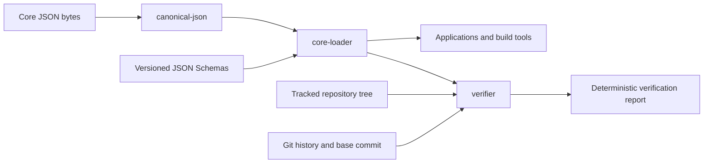

# Core Toolchain

This document defines the high-level software architecture that reads and verifies Open Hadith core data. It explains the responsibilities and trust boundaries of `canonical-json`, `core-loader`, and `verifier`. Detailed byte rules remain in [data-policy.md](data-policy.md), entity meaning remains in [model.md](model.md), and the structural and verification contracts remain in [schema.md](schema.md).

The three packages form a one-directional control chain. They are not three interchangeable validators. Each answers a different question, and each later boundary relies on the guarantees of the earlier boundary without expanding its authority.

## Architecture

The arrows express dependency and trust direction. `canonical-json` knows nothing about Open Hadith entities or repository layout. `core-loader` adds the versioned structural contract but knows nothing about whole-repository relationships or Git history. `verifier` adds repository-wide and historical checks but never becomes a data source. No arrow points back toward an earlier boundary, and none of the three packages writes authoritative core data.

## The three questions

| Boundary | Question answered | Successful guarantee | Deliberately not guaranteed |
|---|---|---|---|
| `canonical-json` | Are these bytes the one approved JSON representation? | The bytes decode, parse without duplicate keys, and exactly match canonical JSON policy. | Entity type, schema validity, repository path, relationships, or source accuracy. |
| `core-loader` | Is this one canonical object a structurally valid Open Hadith record? | The declared type and version select a known schema, structural validation passes, and the returned typed record is deeply immutable. | Semantic checks, foreign references, uniqueness, path agreement, history, or agreement with a printed witness. |
| `verifier` | Does this repository state obey every applicable machine-checkable project rule? | Verification completed and every applicable versioned rule passed. | Scholarly judgement or proof that a transcription matches ink on a physical page. |

A later success includes the earlier guarantees. A verifier cannot evaluate a record as structurally valid before its canonical bytes are trusted, and it cannot evaluate relationships before the record is structurally valid. A canonical or structurally valid record may still be false, misplaced, inconsistent, or historically impermissible.

## `canonical-json`

`packages/canonical-json/` owns deterministic JSON representation. It is a general byte and value boundary rather than an Open Hadith record library.

For canonical input, it:

1. decodes UTF-8 without accepting malformed input or a byte-order mark;
2. enforces LF and the exact final-newline rule;
3. parses with duplicate-key detection and lossless integer handling;
4. requires one top-level object for a canonical core JSON file;
5. checks NFC and the canonical integer-only numeric domain;
6. formats the parsed value deterministically and compares the expected bytes with the input.

Successful parsing returns the JSON value represented by those exact bytes. Failure identifies the violated representation boundary with a stable code and, where meaningful, a byte offset. The package does not consult JSON Schemas, infer record types, traverse the repository, or decide whether content is correct.

Formatting is explicit and separate from verification. A formatter may produce canonical bytes for provisional data, but verification never repairs a file silently. This distinction preserves reviewability: an invalid representation remains visible until a deliberate change corrects it.

## `core-loader`

`packages/core-loader/` is the supported read-only entry point for individual authoritative records. It combines canonical byte handling with the exact versioned structural schemas.

Loader initialization reads the six local schemas, verifies their declared identifiers, validates them against JSON Schema Draft 2020-12, registers their exact local references, and compiles the five entity schemas without network access. If that trusted catalog cannot be established, initialization fails because no record can be loaded safely.

For each file or byte sequence, the loader:

1. requires canonical bytes through `canonical-json`;
2. reads `record_type` and `schema_version` from the canonical object;
3. selects the one known schema for that exact pair;
4. performs strict structural validation without coercion, defaults, property removal, or mutation;
5. deep-freezes the validated value;
6. returns it as the generated discriminated TypeScript record union.

Expected input failures are structured results. File access, canonical representation, unknown record-schema pairs, and structural schema failures remain distinguishable. Successful records are readonly at compile time and recursively frozen at runtime, so downstream code cannot accidentally turn loaded data into a competing in-memory authority.

The TypeScript bindings are generated from the authoritative schemas and committed beside the loader. A deterministic freshness check compares regenerated source byte for byte with the committed binding. The generated interfaces improve development and navigation, but runtime validation remains mandatory and JSON Schema remains authoritative.

The loader intentionally stops at one-record structure. It does not decide whether a record occupies the correct path, whether an identifier is unique, whether another record exists, whether a fingerprint matches, whether a page range is ordered, or whether an identifier was reused. Adding those checks to the loader would make an ordinary record read depend on the whole repository and would blur the boundary between consumption and verification.

## `verifier`

`packages/verifier/` is the repository admission control. It consumes the loader boundary and adds the context that a single-record loader deliberately lacks: tracked paths, the complete record set, cross-record indexes, an explicit Git base, and repository history.

Verification runs in prerequisite order:

1. discover the required tracked files and trusted repository context;
2. check byte representation before trusting parsed values;
3. establish the schema catalog and load structurally valid records;
4. evaluate record-local semantic rules;
5. build indexes and evaluate uniqueness, ordering, and relationships;
6. evaluate historical permanence and minting rules against the resolved base commit;
7. sort all safely evaluable findings and serialize one deterministic report.

A failed prerequisite invalidates the repository and prevents only checks that cannot be evaluated honestly. It never becomes a false pass for dependent rules. Missing schemas, unavailable required history, internal errors, and incomplete execution cannot produce a valid report.

The verifier reports findings; it does not fix them. Its machine report contains only the settled verification version, validity, and sorted findings. Terminal presentation is derived from that report. Exit status `0` means complete success, `1` means complete verification found rule failures, and `2` means verification could not complete.

Verification proves repository consistency under the published machine rules. It cannot prove that preserved text matches the cited physical source witness or that a human-authored grouping is scholarly correct. Those claims remain independently checkable because the core records preserve the exact witness and location needed for human review.

## How the boundaries are used

Applications and static builders use `core-loader` or deterministic artifacts built through it. They do not run historical repository verification for every ordinary read, and they do not use unchecked `JSON.parse` results as core records.

Continuous integration and maintainers use `verifier` before admitting changes to authoritative data. Passing package tests proves the tools behave as specified; passing repository verification proves the candidate repository state satisfies the implemented rule catalog. Neither substitutes for reviewed comparison with a physical source witness.

Ingestion and minting tools may use canonical formatting and structural loading while preparing private candidates. They write only to their private workspaces. A successful load does not authorize promotion into `core/`; promotion remains an explicit reviewed repository change that must pass the complete verifier.

Human and AI maintainers use the same boundaries. Canonical failures are representation problems, loader failures are one-record structural problems, verifier findings are named repository-rule failures, and questions about the physical edition remain human verification problems. Keeping these categories distinct prevents a tool result from claiming more than it proves.

## Change routing

| Proposed change | Primary authority and implementation boundary |
|---|---|
| JSON bytes, encoding, normalization, escaping, number notation, or canonical formatting | `docs/data-policy.md` and `canonical-json` |
| Entity fields, structural constraints, common semantic types, or schema versions | `docs/schema.md`, `schemas/`, and regenerated loader bindings |
| Meaning, identity, provenance, or relationships of project entities | `docs/terms.md` and `docs/model.md` before implementation |
| One-record loading API, structural diagnostics, or immutable typed access | `core-loader` and this document |
| Machine-checkable semantic, repository, relationship, or history rule | The versioned catalog in `docs/schema.md` and `verifier` |
| Physical-source agreement or scholarly judgement | Human review and governance, never a fabricated machine rule |
| Search, display, export, or normalization behavior | Derived or application layers, never the core toolchain authority |

When a proposal crosses rows, each affected contract changes explicitly. A semantic check is not hidden in a loader convenience function, a structural field is not invented only in TypeScript, and an application requirement does not redefine canonical core data.

## Implementation status

`canonical-json` and `core-loader` implement their complete initial boundaries. The verifier implements its immutable finding and report protocol, deterministic prerequisite runner and serialization, stable incomplete outcomes, and exit-status presentation. It also compiles and exercises the structural schema catalog through `core-loader`. Repository traversal, named rule integration, semantic rules, cross-record rules, and historical rules remain under implementation. Until those rule families are complete, no authoritative core record is admitted.

## The rule

Canonical JSON establishes trustworthy bytes. The core loader establishes one trustworthy structured record. The verifier establishes a trustworthy repository state under the machine-checkable project rules. Each boundary adds context, none rewrites data, and none claims to prove the physical source.
